# IKAT PRO

Демо-сайт видеопродакшна IKAT PRO из Ташкента: реклама, имиджевые фильмы, контент для соцсетей и аренда студии для подкастов.

Сайт: https://ikat.sanjar.design

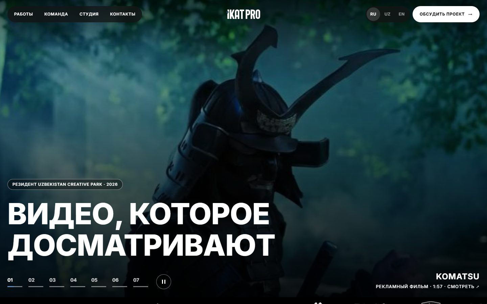

## Страницы

| Страница | Файл | Что на ней |
| --- | --- | --- |
| Главная | `index.html` | Карусель работ на первом экране, клиенты, мозаика работ с фильтрами, письма клиентов, контакты |
| Работа | `work.html?w=<slug>` | Видео проекта, кадры, кнопки заявки и Telegram |
| Студия | `about.html` | Аренда зала 50 м²: ключевые цифры, тарифы, площадка, техника и условия |
| Команда | `team.html` | 11 человек по отделам, кому писать по рекламе, студии и соцсетям |
| Контакты | `contacts.html` | Телефон, почта, адрес, карта, контакты по направлениям |

### Работа

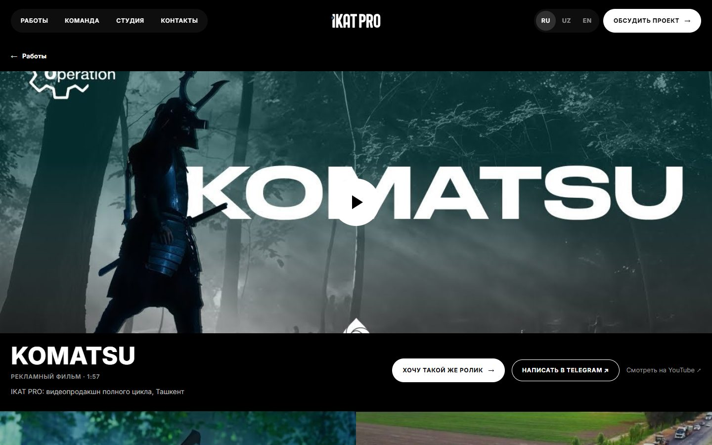

### Студия

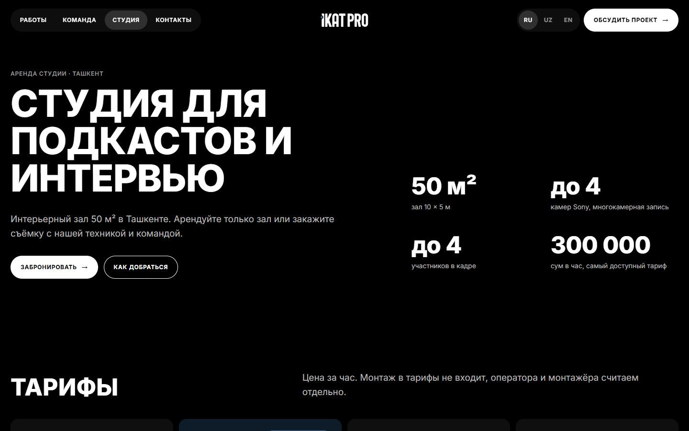

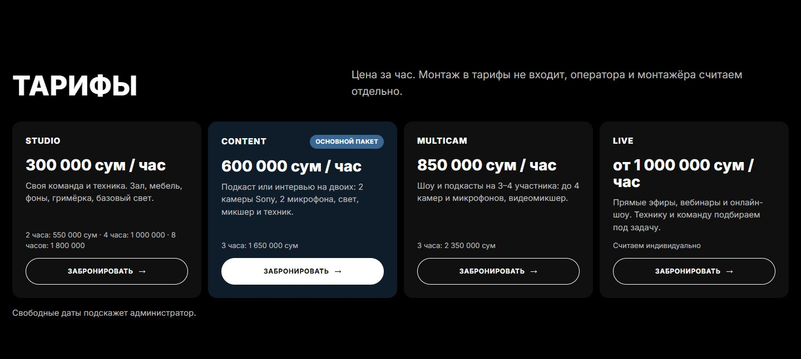

### Команда и контакты

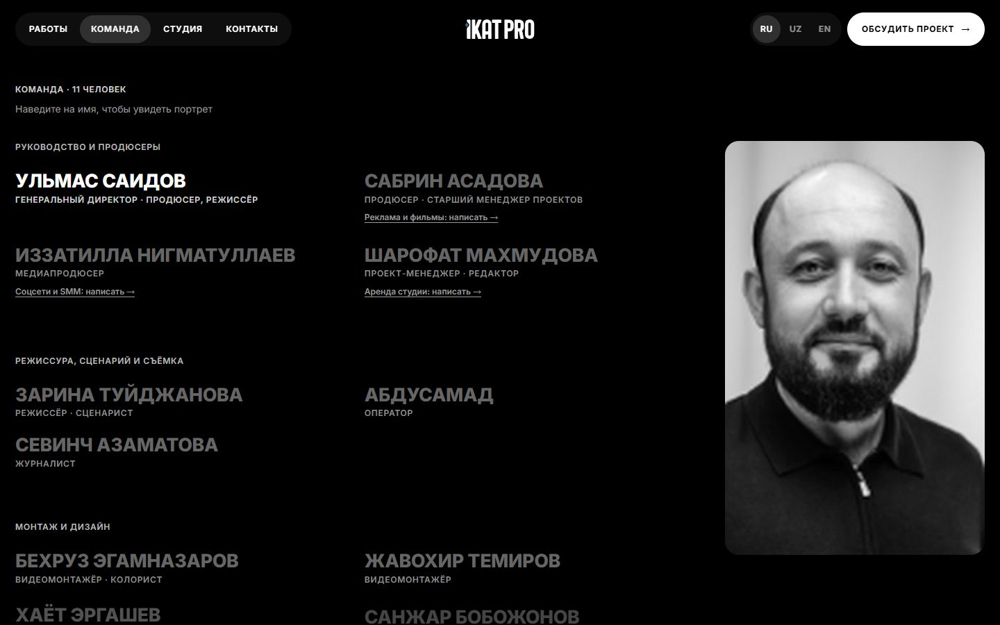

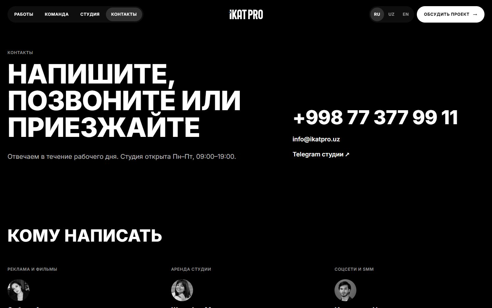

### На телефоне

<p>
  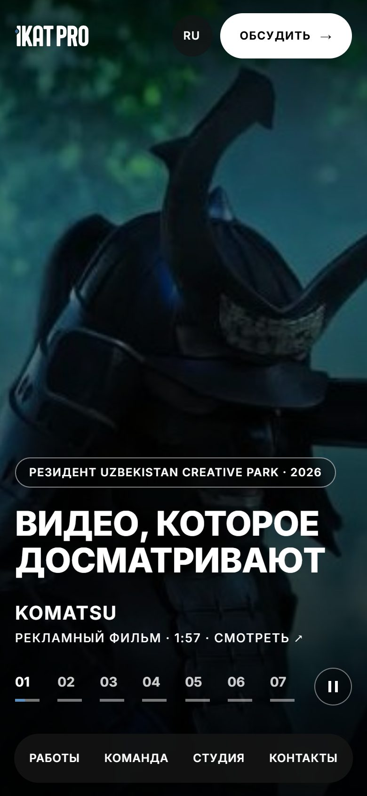
  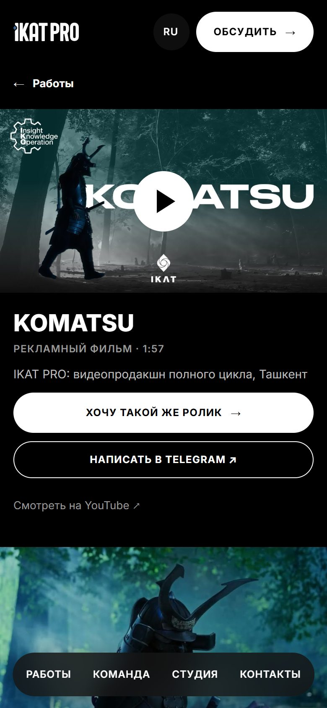
  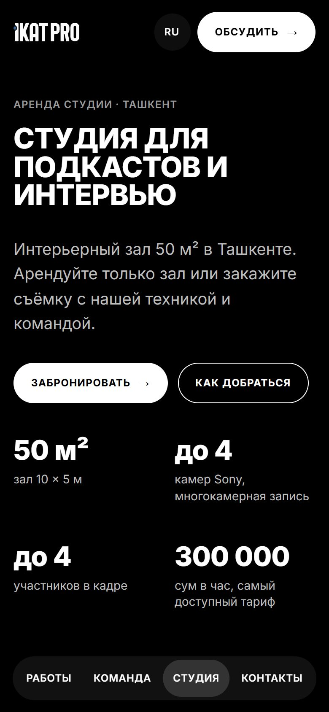
  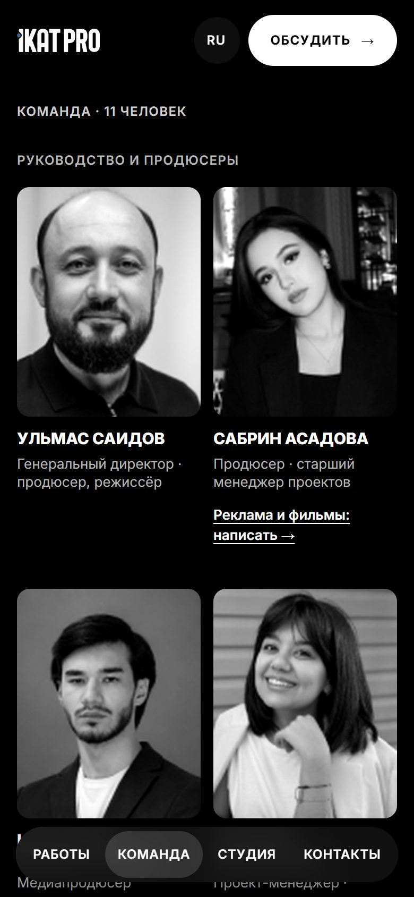
  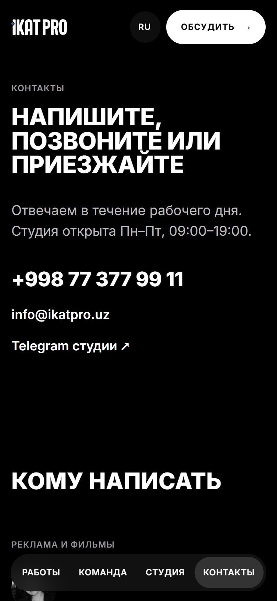
</p>

На телефоне меню переезжает в нижнюю панель, чтобы до разделов доставал большой палец.

## Что умеет сайт

- Три языка: русский (основной), узбекский на новой латинице и английский. Выбор языка сохраняется в браузере.
- Форма «Обсудить проект» открывается с любой кнопки заявки и сразу подставляет тип: реклама, фильм, соцсети или аренда студии.
- Тёмная тема на всех страницах.
- Анимации отключаются, если в системе включено «Уменьшить движение».
- Сайт работает и при открытии файлов с диска, без сервера.

## Технологии

HTML, CSS и JavaScript без фреймворков и без сборки. Шрифт Inter лежит в `fonts/`, внешних зависимостей нет.

```
index.html, work.html, about.html, team.html, contacts.html
css/style.css     стили всех страниц
css/fonts.css     подключение Inter
js/i18n.js        тексты на трёх языках
js/main.js        общее поведение: язык, анимации, карусель, мозаика работ
js/work.js        страница работы
js/form.js        форма заявки
js/track.js       заготовка аналитики
data/works.js     список работ
data/letters.js   письма клиентов
assets/           обложки, кадры, логотипы клиентов, фото команды, сканы писем
```

Тексты страниц хранятся в `js/i18n.js` по ключам, разметка ссылается на них через атрибуты `data-i18n`. Чтобы поменять текст, правьте его во всех трёх языках.

Новую работу добавьте в `data/works.js`: адрес страницы берётся из поля `slug`, обложка и кадры лежат в `assets/covers/` и `assets/img/`.

## Запуск локально

```bash
python -m http.server 3211
```

Откройте http://localhost:3211.

## Что пока не готово

- Заявки никуда не уходят: форма проверяет поля, показывает «Спасибо» и пишет заявку в консоль браузера. Перед запуском нужно подключить отправку, например в Telegram-бот или CRM.
- Аналитика тоже пишет события только в консоль.
- В квадратных скобках, например `[уточнить]` или `[фото зала]`, стоят места для фактов и материалов, которые ещё ждём от студии.
